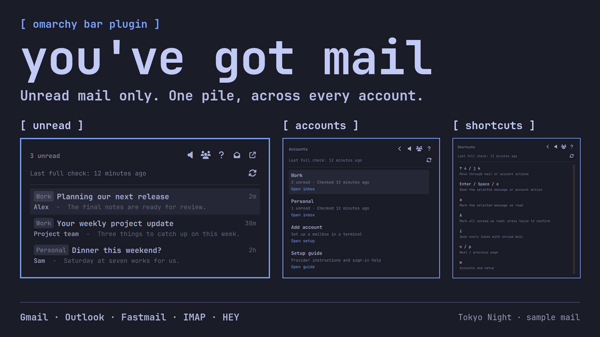

# You've Got Mail

An Omarchy bar widget for **unread mail only**. One pile across every account
you add; click a row to open that message in the browser. Read mail is never
listed. Gmail, HEY, Outlook, Fastmail and IMAP are built in.

<p align="center">
  
</p>

<p align="center"><sub>Sample mail, version 3.0.0.</sub></p>

## Requirements

- [Omarchy](https://omarchy.org/) 4.5 or later. On Omarchy 4.0, use
  [2.10.0](docs/UPDATING.md#staying-on-omarchy-40).
- `python3`, and `jq` for Gmail.
- For each mailbox, its provider's tool or credentials: [gws] for Gmail,
  [hey-cli] for HEY, a Microsoft Graph app registration for Outlook, an API
  token or app password for Fastmail and IMAP. [docs/ACCOUNTS.md](docs/ACCOUNTS.md)
  has the steps.

## Install

```bash
omarchy plugin add https://github.com/BVisagie/omarchy-you-got-mail.git --enable
omarchy bar move bvisagie.you-got-mail --section right
```

No sudo is needed. Omarchy clones the repository, validates the manifest and
enables the widget.

## Add an account

Open the panel, press `m` for **Accounts**, then **Add account**: the setup
wizard opens in a terminal. Or run it yourself:

```bash
~/.config/omarchy/plugins/bvisagie.you-got-mail/bin/you-got-mail accounts add
```

With no account added, a single Gmail account is assumed. Every provider,
sign-in and fix is in [docs/ACCOUNTS.md](docs/ACCOUNTS.md).

## Using it

Click the bar icon to open the panel, and a message to open it in the browser
and take it off the pile (an IMAP account opens its webmail, if you gave
one). Middle-click refreshes; right-click opens every inbox with unread mail. In the panel, `?` lists every key and `m` shows your
accounts. A `!` on the mailbox means mail needs attention, and the tooltip
says why.

Controls, the keybinding, settings, the optional "You've got mail!" sound and
languages are in [docs/USAGE.md](docs/USAGE.md).

## Update

```bash
omarchy plugin update bvisagie.you-got-mail
omarchy restart shell
```

More in [docs/UPDATING.md](docs/UPDATING.md), including staying on Omarchy
4.0. [CHANGELOG.md](CHANGELOG.md) lists what changed.

## Removing it

To remove accounts and sign out of each provider, do it first, while the
plugin's command is still there: see
[docs/ACCOUNTS.md § Revoking access](docs/ACCOUNTS.md#revoking-access). Then:

```bash
omarchy plugin remove bvisagie.you-got-mail
```

That leaves `~/.config/omarchy-you-got-mail/` (accounts and secrets) and
`~/.cache/omarchy-you-got-mail/` in place; delete them yourself if the machine
is changing hands.

## Documentation

- [docs/USAGE.md](docs/USAGE.md) — controls, keybinding, settings, sound, languages
- [docs/ACCOUNTS.md](docs/ACCOUNTS.md) — adding accounts, each provider, troubleshooting
- [docs/UPDATING.md](docs/UPDATING.md) — updating, staying on Omarchy 4.0
- [docs/PROVIDERS.md](docs/PROVIDERS.md) — writing a new provider
- [CHANGELOG.md](CHANGELOG.md)

## License

MIT

[gws]: https://github.com/googleworkspace/cli
[hey-cli]: https://github.com/basecamp/hey-cli
