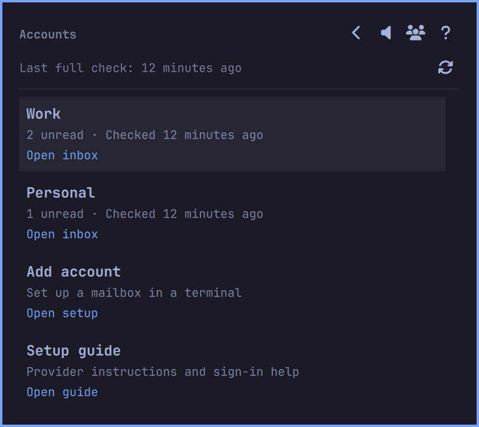
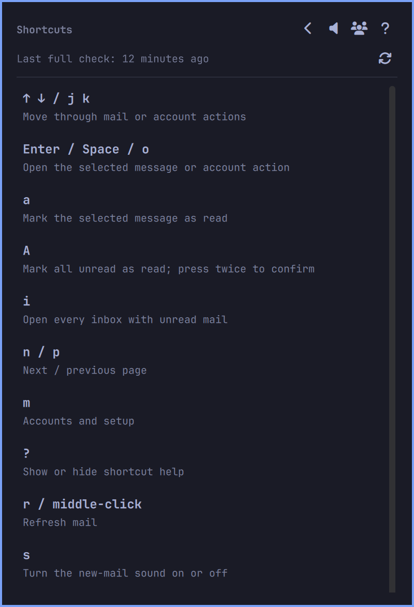
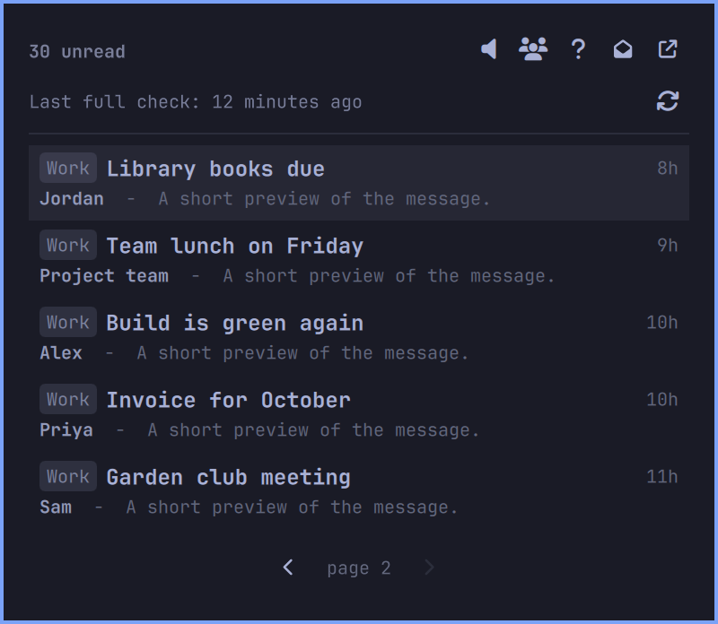
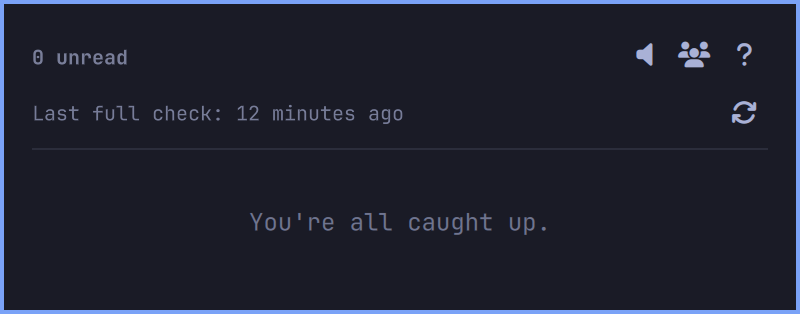

# Using You've Got Mail

- [Controls](#controls)
- [The panel](#the-panel)
- [When something fails](#when-something-fails)
- [Settings](#settings)
- [Sound](#sound)
- [Language](#language)
- [Screenshots](#screenshots)

## Controls

| | |
|---|---|
| Click the bar icon | open or close the panel |
| Right-click the bar icon | open each inbox that currently has unread, one tab per inbox address; accounts without a webmail URL are skipped, and accounts sharing one address open it once |
| Middle-click the bar icon, refresh button, or `r` | refresh now |
| Accounts button or `m` | account counts, individual inbox links, Add account, setup guide |
| Help button or `?` | keyboard and mouse controls |
| Speaker button or `s` | turn the new-mail sound on or off |
| Header envelope-open or `A` | mark all unread as read (click or press twice to confirm) |
| `a` | mark the message under the cursor as read, without opening it |
| Header external-link or `i` | same as right-click |
| Click a message | open **that** thread in the browser and take it off the pile; an IMAP account opens its webmail inbox if one is set, and otherwise only marks the message read |
| `↑` `↓` or `j` `k` | move through mail or account actions; scroll help |
| `Enter`, `Space` or `o` | open the selected message or account action |
| `n` / `p` | next page, previous page |
| `Tab` / `Shift+Tab` | switch to the next or previous bar panel |
| `x` or action-error × | dismiss an action error |
| `Esc` | return from Accounts/Help, cancel mark-all confirm, or close |

To open or close the panel from the keyboard, add a binding to
`~/.config/hypr/bindings.lua`:

```lua
o.bind("SUPER + CTRL + M", "Mail", { panel = "bvisagie.you-got-mail" })
```

`SUPER + CTRL + M` is free on a stock Omarchy 4.5; `omarchy menu keybindings
--print` lists what is taken on yours.

## The panel

The bar tooltip shows the unread count, or why mail needs attention. A `!` on
the mailbox means mail needs attention, not unread mail.

With more than one account the badge is the sum of unread, rows are
newest-first, and each row shows an account chip. The badge is the provider's
mailbox total, not just the rows on this page. Paging walks a cap of the 200
newest messages across accounts. Mark-all as read uses the same mailbox
total: it is not limited to the current page.

**Accounts** (`m`) shows each account's current count and opens just that
inbox, even if it has no unread mail. Accounts without a webmail URL cannot
be opened. Failed accounts say **Unavailable** rather than showing a zero
count.

The panel and tooltip show the **last full check**. Accounts lists each
mailbox's last successful check; a failed mailbox keeps its previous time,
and a partial success never advances the full-check time. These times are
held in memory and start fresh when the plugin reloads.

The panel refreshes on the interval from [settings](#settings) (one minute by
default), and again when you open it or click a row. Set the interval to `0`
to turn timed checks off; mail is then checked when the plugin starts, when
you open the panel, and when you refresh. Relative time labels update without
fetching mail.

## When something fails

If one account fails, the others still show and the panel names the failure,
even when the healthy mailboxes are empty. An expired sign-in shows, for
example, **Gmail needs you to sign in again** with the command that fixes it.
Click the command (or ▶) to run it in a floating terminal, or ⧉ to copy it.
When a provider's tool is missing, **Open setup guide** opens its section of
[ACCOUNTS.md](ACCOUNTS.md). More fixes are in
[ACCOUNTS.md § Troubleshooting](ACCOUNTS.md#troubleshooting).

If marking a message read fails, its row and count come back and the panel
shows the error, including after reopening. The browser still opens at once.
A newer notice replaces an older one. Dismiss it with × or `x`; a successful
mark-all without warnings also clears it.

## Settings

Page size, refresh interval and the new-mail sound are bar widget settings on
the `bvisagie.you-got-mail` entry in `~/.config/omarchy/shell.json`.
Omarchy's widget settings write the same keys.

| Key | Default | Range |
|---|---|---|
| `max` | 25 | 1–50 messages per page |
| `refreshIntervalSec` | 60 | 15–3600, or 0 for no timed checks |
| `soundEnabled` | `false` | `true` plays the [new-mail sound](#sound) |
| `soundCooldownSec` | 60 | 0–3600 seconds before the sound can play again |
| `soundVolume` | 100 | 0–100 |
| `soundFile` | empty | your own sound file; empty plays the bundled clip |

Accounts, tokens and passwords live in `~/.config/omarchy-you-got-mail/`, not
in `shell.json`; see [ACCOUNTS.md § Where things live](ACCOUNTS.md#where-things-live).
The CLI's `list` without `--limit` also honours `YOU_GOT_MAIL_MAX` and an
older `~/.config/omarchy-you-got-mail/config` with `max = 25`; the panel
always passes `--limit`.

## Sound

The widget can say "You've got mail!" when new unread mail arrives. It is off
by default. The speaker button in the panel header, or `s`, turns it on or
off; turning it on plays it once (unless Do Not Disturb is on), and turning
it off silences a sound still waiting to play.

It plays once when a refresh finds new mail, however many messages arrived,
and only once with a bar on several monitors. It stays quiet when the plugin
starts or reloads, when you page, and when reading mail brings older unread
into view. Mail that arrived while the computer slept or was offline gets one
sound, on the next successful refresh. It plays at most once every
`soundCooldownSec` seconds; mail that arrives in between gets one sound when
that time is up. It never plays while Do Not Disturb is on. New mail is
noticed by a successful refresh of the first page, while it is still unread:
within one refresh interval with timed checks, as long as the panel is not
left on a later page, or when you next open the panel or refresh with them
off. The sound then plays at once, or when the quiet time ends.

To use your own sound, set `soundFile` to a local audio file, with a full
path or one starting with `~`, such as `~/Music/ding.oga`. Sounds longer than
15 seconds are cut off, and a file that can't be played falls back to the
bundled clip. Playback uses `pw-play` (PipeWire), or `paplay` if `pw-play` is
missing, and retries a few times over the next minute and a half if the
sound can't play, for example while PipeWire restarts.

To hear it now:

```bash
~/.config/omarchy/plugins/bvisagie.you-got-mail/bin/you-got-mail chime
```

Add `--file` with your `soundFile` path to test that, or `--volume 0-100`. If
your file can't be played, you hear the bundled clip and the output says why
under `fallback`. While Do Not Disturb is on it prints
`{"ok": true, "skipped": "dnd"}`; if it prints that with Do Not Disturb off,
`omarchy-shell notifications isDnd` is failing.

The bundled voice is AI-generated; see [sounds/README.md](../sounds/README.md).

## Language

The panel follows the language picked under **Setup > Language**, without a
restart. Its text lives in [`i18n/en.json`](../i18n/en.json). It ships in
English for now; a translation is one more file beside it, such as
`i18n/de.json`, with the same keys. A string missing from a translation falls
back to English. Mail, account names, and messages from the providers and
their tools are shown as they arrive.

## Screenshots

Sample mail, version 2.8.0.

<p align="center">
  
  &nbsp;&nbsp;
  
</p>

<p align="center">
  
  &nbsp;&nbsp;
  
</p>
